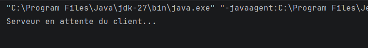
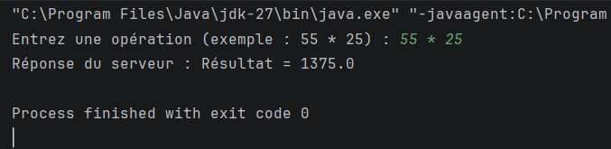
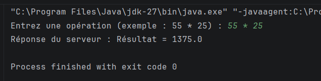
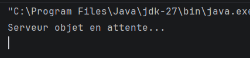
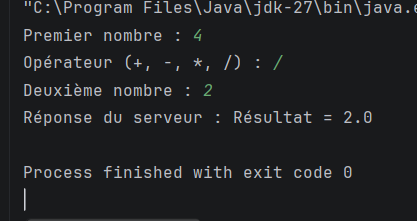
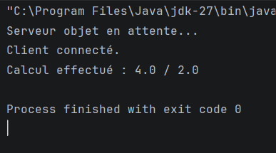

# TP2 DAR — Sockets TCP : échange de chaînes de caractères et d'objets

## 1. Présentation

Ce projet est réalisé dans le cadre du TP2 de Développement
d'applications réparties.

L'objectif est de comprendre la communication entre un client
et un serveur en Java à l'aide des sockets TCP.

Deux méthodes d'échange sont étudiées :
- L'échange de chaînes de caractères.
- L'échange d'objets Java avec l'interface Serializable.

## 2. Environnement de travail

- Langage : Java
- JDK : version 8 ou supérieure
- IDE : IntelliJ IDEA
- Communication : sockets TCP

## 3. Organisation du projet

- clientPackage/Client.java : client de l'activité 2-1.
- serverPackage/Server.java : serveur de l'activité 2-1.
- clientPackage/Client2.java : client de l'activité 2-2.
- serverPackage/Server2.java : serveur de l'activité 2-2.
- clientPackage/Operation.java : objet représentant une opération.
- Main.java : fichier conservé dans le projet.

## 4. Activité 2-1 — Échange de chaînes de caractères

Le client envoie une opération complète sous forme de texte.
Le serveur analyse l'opération, effectue le calcul et renvoie
le résultat au client.

Les opérations prises en charge sont :
- Addition (+)
- Soustraction (-)
- Multiplication (*)
- Division (/)

Le programme vérifie également la syntaxe et empêche la
division par zéro.

Exemple :
- Opération envoyée : 55 * 25
- Résultat reçu : 1375.0

## 5. Activité 2-2 — Échange d'objets

La classe Operation implémente Serializable.
Elle contient le premier opérande, l'opérateur et le deuxième
opérande.

Le client envoie cet objet au serveur. Le serveur récupère
les valeurs, effectue le calcul puis renvoie le résultat.

Exemple :
- Premier opérande : 44
- Opérateur : /
- Deuxième opérande : 2
- Résultat reçu : 2.0

## 6. Captures d'écran

### Activité 2-1

### Activité 2-2

## 7. Conclusion

Ce TP permet de comprendre l'échange de données entre deux
applications Java avec les sockets TCP, d'utiliser les flux
de caractères et d'apprendre à transmettre des objets
sérialisables.
